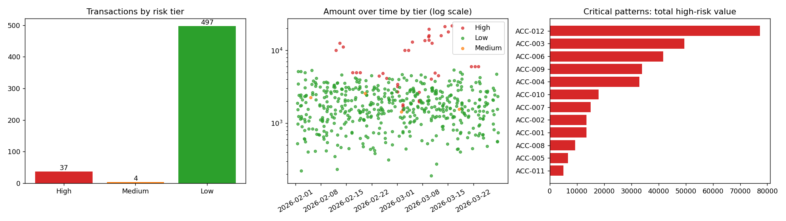

# Operational Anomaly Detection & Risk Analysis

**Stack:** Python (pandas, NumPy)

Hypothesis-driven analysis of 500+ transaction records that flags high-risk anomalies, groups them into critical
patterns, and produces a risk-tier classification report with recommended actions.

> **Data note:** the dataset is **synthetic** (`src/generate_transactions.py`, fixed seed). I injected 37 anomalous
> transactions across 12 accounts, plus 18 benign edge cases (late-night purchases, daytime travel, a new phone) to test
> for false alarms. Rule thresholds were set with that data in mind, so "caught 37/37" shows the rules work as designed
> on a controlled dataset. It is **not** a claim of real-world detection performance.



## Method
Each hypothesis is a transparent rule with a weight; the risk score is the sum of triggered weights.

| Rule | Hypothesis | Weight |
|---|---|---|
| `amount_outlier` | amount >= 3.5x the account's own median (normal data peaks at ~2.3x) | 35 |
| `foreign` | transaction country differs from home country | 25 |
| `off_hours` | between 00:00 and 04:59 | 20 |
| `new_device` | device is not the account's usual device | 20 |
| `velocity` | 3+ transactions on one account within 30 minutes | 20 |
| `round_amount` | multiple of 1,000 and >= 5,000 | 15 |

**Tiers:** High >= 60, Medium 30-59, Low < 30.
**Critical pattern:** an account with 2+ High-risk transactions.

## Results
| Metric | Value |
|---|---|
| Transactions analysed | 538 |
| **High-risk anomalies flagged** | **37** (6.9%) |
| **Critical patterns (accounts)** | **12** |
| Medium / Low | 4 / 497 |
| Injected anomalies caught / false alarms in High tier | 37 of 37 / 0 |

Full write-up with tier actions and recommendations: [`outputs/risk_report.md`](outputs/risk_report.md).

## How to run
```bash
pip install -r requirements.txt
python src/generate_transactions.py
python src/detect_anomalies.py
python src/risk_report.py
```

## Repo structure
```
src/      generate_transactions.py, detect_anomalies.py, risk_report.py
data/     transactions.csv, injected_labels.csv (answer key, not used by the detector)
outputs/  scored_transactions.csv, high_risk_anomalies.csv, critical_patterns.csv, risk_tier_summary.csv, risk_report.md
docs/     risk_overview.png
```

## Limitations
Rules and weights are hand-set and the data is simulated. On real data I would calibrate thresholds on labelled history,
measure precision/recall properly, and compare against a statistical model such as Isolation Forest.
